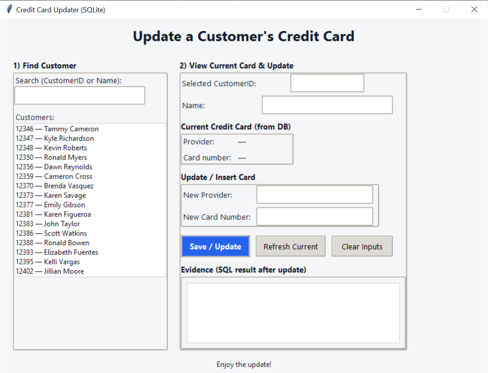
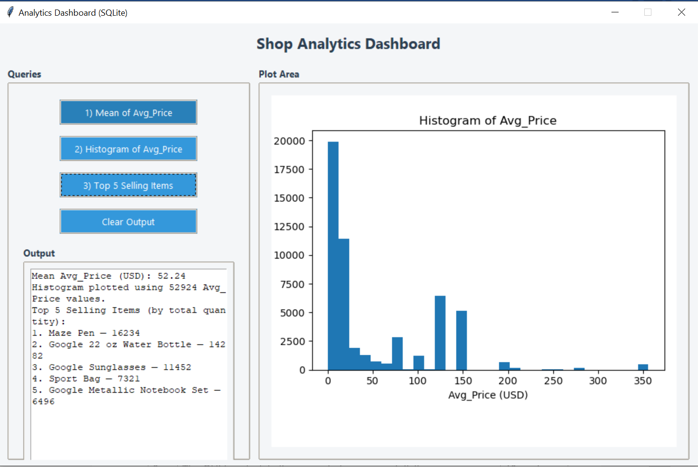
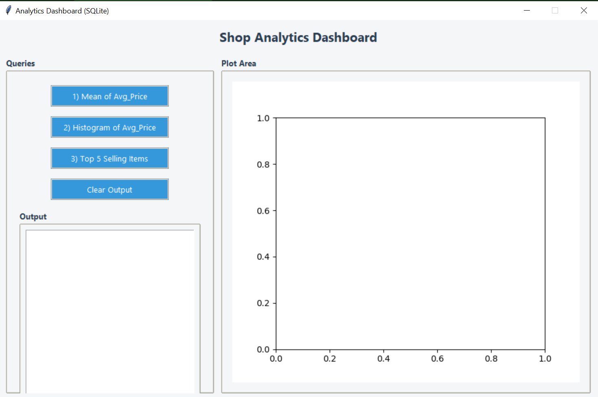

# Retail Transactions Database & Data Quality Project

A Python, pandas and SQLite project that converts retail transaction data into a relational database, investigates inconsistent records, and provides two Tkinter interfaces for record maintenance and analytics.

## Highlights

- Audited a transaction-item dataset containing more than **52,000 records**.
- Identified **1,319 transaction IDs** associated with more than one customer ID. Resolved inconsistencies using the modal customer ID for each transaction, breaking ties with the smallest ID.
- Modelled five linked tables: `Customer`, `Product`, `SalesTransaction`, `TransactionItem`, and `CreditCard`, with primary/foreign key constraints.
- Built a **Credit Card Updater GUI** for customer lookup and updates, with SQL verification.
- Built an **Analytics Dashboard GUI** for SQL-based measures and visual exploration, including price distributions and top-selling products.
- Added Fernet encryption/decryption helpers for card fields in the local demonstration workflow.


## Application Screenshots

The screenshots below demonstrate the Tkinter applications developed for this project. The customer records and payment-card numbers shown are fictional and used for demonstration purposes.

### 1. Credit Card Updater — Customer Search

The application allows users to search for customers using their name or CustomerID, select a record, and view existing payment-card information.



### 2. Credit Card Updater — Successful Update

The application supports inserting and updating payment-card details. Following an update, an SQL query verifies the saved information, and a confirmation message is displayed.



### 3. Retail Analytics Dashboard

The dashboard provides SQL-based analysis of retail data, including average product prices, price distributions and the five best-selling products by quantity.


  

## Project structure

| File | Purpose |
|---|---|
| `data_preparation.ipynb` | Inspect, clean, reconcile and load the data into SQLite. |
| `credit_card_gui.ipynb` | Tkinter interface for customer searches and updating payment-card records. |
| `analytics_dashboard_gui.ipynb` | Tkinter interface for database queries and charts. |
| `crypto_utils.py` | Local encryption helper; generates a separate `secret.key` at runtime. |
| `VariableDefinitions.txt` | Dataset field descriptions. |
| `requirements.txt` | Python dependencies. |

## Workflow

1. Load `file.csv`, `customer.csv`, and `creditCard.csv` locally.
2. Audit keys and investigate inconsistencies in transaction/customer associations.
3. Apply a documented mode-based correction rule and prepare normalised entities.
4. Build and populate `shop.db` with relational constraints.
5. Open the GUI notebooks to inspect analytics or maintain records.

## Setup

Use Python 3 with a working Tkinter installation. Install Python packages with:

```bash
pip install -r requirements.txt
```

The original CSV datasets and populated SQLite database are **intentionally not distributed** in this public repository because they include personal and payment-card fields. To execute the notebooks, use authorised local datasets with the expected column structure or suitable synthetic data, and place those CSV files beside the notebooks. Run the preparation notebook before the GUI notebooks. The preparation notebook includes stateful, exploratory cells, so review their order before running all cells.

The GUI applications depend on a local `shop.db`. The encryption helper creates `secret.key` locally; **never commit this file**. The use of Fernet is an instructional demonstration, not a claim of production payment-card security or PCI compliance.

## Data privacy

No original customer CSV, card-number dataset, populated database, notebook outputs, report documents or unreviewed screenshots are included. The repository `.gitignore` excludes these files to help prevent accidental uploads. Use only synthetic or appropriately authorised data in public demonstrations.

## Skills demonstrated

Python · pandas · SQL · SQLite · Data quality · Data cleaning · Relational modelling · Referential integrity · Tkinter · Matplotlib · Encryption basics
